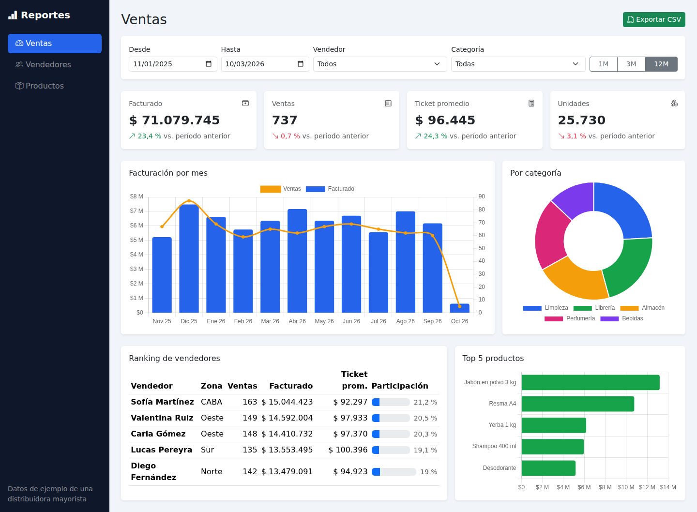
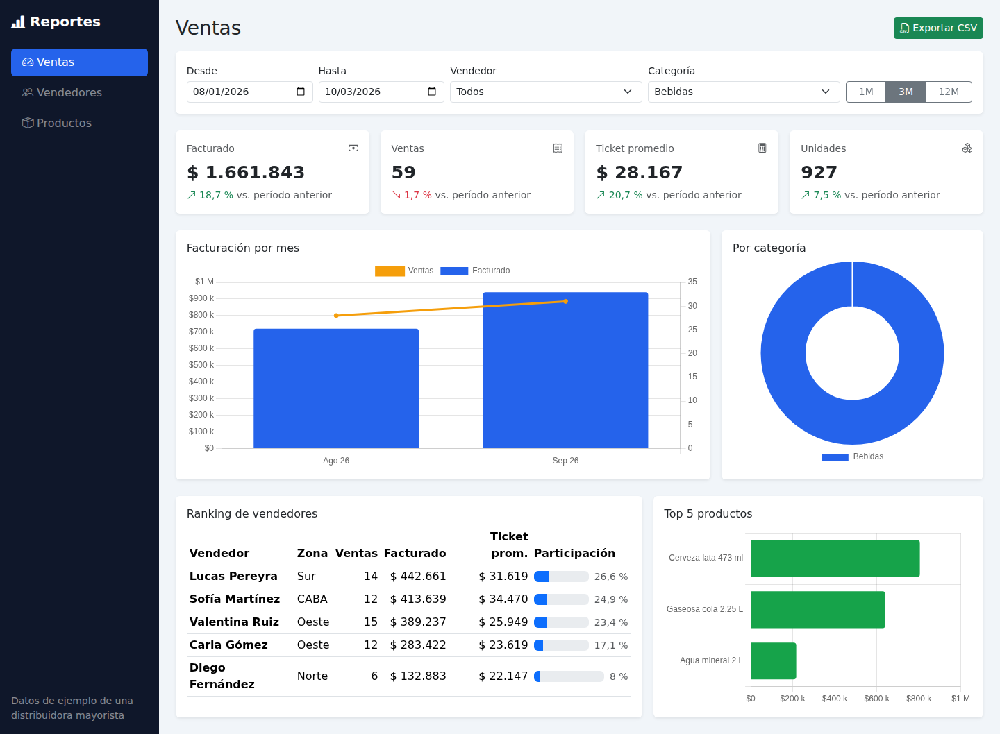
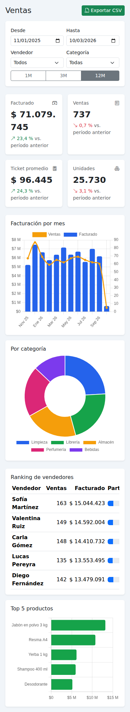

# Panel de reportes de ventas

[English version](README.en.md)

Dashboard administrativo para una distribuidora mayorista, hecho en **PHP sin frameworks** (compatible con PHP 5.6 a 8.x), **SQL**, **jQuery + Ajax**, **Bootstrap 5** y **Chart.js**.



## Funcionalidades
- Indicadores del período: facturado, cantidad de ventas, ticket promedio y unidades, cada uno comparado contra el período anterior de igual duración.
- Gráfico de facturación y cantidad de ventas por mes, con dos ejes.
- Distribución por categoría y top 5 de productos.
- Ranking de vendedores con participación sobre el total.
- Filtros por fecha, vendedor y categoría, con rangos rápidos (1, 3 y 12 meses). Todo se recalcula por Ajax sin recargar.
- Exportación a CSV del detalle filtrado, lista para abrir en Excel.

## Modelo de datos
```
vendedores 1───N ventas 1───N venta_items N───1 productos N───1 categorias
```
El precio se guarda en cada renglón (`venta_items.precio_unitario`), así los reportes históricos no cambian cuando se actualiza la lista de precios.

## Consultas destacadas (`includes/reportes.php`)
- **Base común:** un solo `FROM` con 4 `JOIN` y los filtros armados con consultas preparadas. Todos los reportes la reutilizan.
- **Por mes:** `GROUP BY` sobre la fecha formateada. Usa `DATE_FORMAT` en MySQL y `strftime` en SQLite, porque cada motor tiene su función.
- **KPIs:** `SUM(cantidad * precio_unitario)`, `COUNT(DISTINCT v.id)` (una venta tiene varios renglones) y `COUNT(DISTINCT cliente)`.
- **Ranking:** `GROUP BY` + `HAVING` + `ORDER BY`. La participación se calcula sobre el total con los mismos filtros.
- **Exportación:** recorre el resultado fila por fila con `fetch()` y `fputcsv` hacia `php://output`, sin cargar todo en memoria. Agrega BOM UTF-8 y usa `;` como separador para Excel en español.

## Casos de uso documentados
| # | Caso | Resultado esperado |
|---|---|---|
| 1 | Abrir el panel sin filtros | Muestra los últimos 12 meses y compara con los 12 anteriores. |
| 2 | Elegir "Bebidas" y el rango 3M | Se recalculan KPIs, gráficos y ranking; el link de exportar lleva los mismos filtros. |
| 3 | Fechas inválidas en la URL (`desde=xx`) | Se ignoran y se usa el rango por defecto. |
| 4 | Período sin ventas | KPIs en 0 y "Sin ventas en el período" en el ranking. |
| 5 | Exportar CSV | Descarga `ventas_<desde>_a_<hasta>.csv` con fechas dd/mm/aaaa y decimales con coma. |

## Instalación
**Local (modo demo):** `php -S localhost:8000`. Crea `data/demo.sqlite` con 24 meses de ventas generadas (siempre las mismas, por la semilla fija).

**Servidor con MySQL:**
1. Ejecutar `sql/schema.sql`.
2. Generar los datos con `php sql/generar_datos.php > sql/datos.sql` y ejecutarlos.
3. Completar `includes/config.php` y subir los archivos.

## Capturas
| Filtrado por categoría | Celular |
|---|---|
|  |  |
